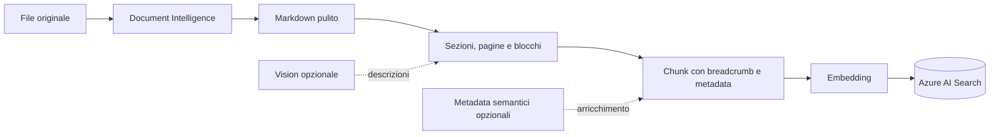
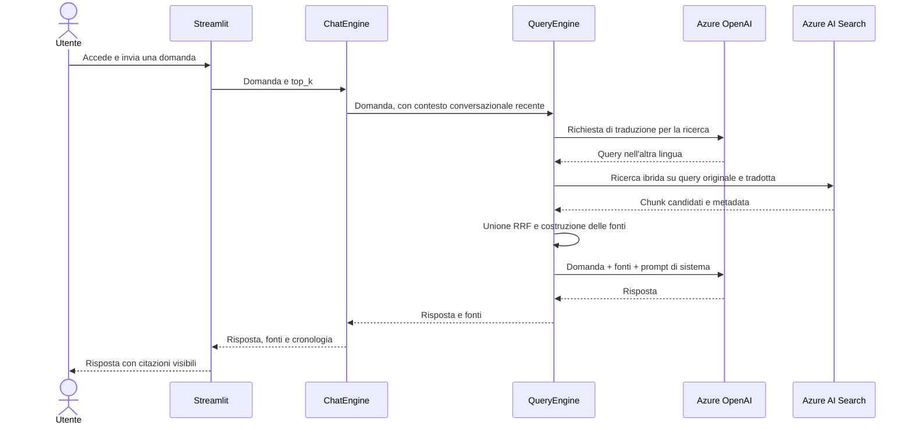

# Funzionamento generale dell'app

RAGSimple è un'app di chat che risponde usando documenti indicizzati. Prima cerca passaggi pertinenti nella knowledge base Azure; poi chiede al modello di rispondere usando quei passaggi, invece di affidarsi solo alla sua conoscenza generale.

## Parti dell'app

| Parte | Cosa fa |
|---|---|
| Streamlit | Interfaccia chat, fonti, numero di risultati e cronologia della sessione. In produzione, richiede login OIDC e controlla l'allowlist. |
| `ChatEngine` | Gestisce i messaggi della sessione e prepara il contesto delle domande successive. |
| `QueryEngine` | Traduce per la ricerca multilingue, recupera fonti, le ordina e prepara la richiesta al modello. |
| `RagClient` | Collega LLM, embedding, Azure AI Search e ingestione. |
| Azure AI Search | Memorizza i chunk, i vettori e i metadata; risponde alle ricerche. |
| Azure OpenAI | Produce embedding, traduce la domanda e formula la risposta finale; Vision e metadata semantici sono facoltativi. |
| Azure Document Intelligence | Durante l'ingestione estrae layout, testo, tabelle e pagine dai documenti. |
| FastAPI | Espone `/search`, `/ingest` e operazioni sull'indice. È un servizio separato dall'interfaccia Streamlit. |

## Percorso di un documento

L'ingestione convalida il file, lo normalizza, lo divide in sezioni e chunk, crea gli embedding e sostituisce nell'indice i chunk precedenti con la stessa chiave documento. La descrizione di chunking è in [CHUNKING.md](CHUNKING.md); il dettaglio di vettori e ricerca è in [VECTORIZATION.md](VECTORIZATION.md).

## Percorso di una domanda

La UI mostra le fonti per default. Ogni fonte riporta documento, sezione e pagina quando disponibili. Il prompt di sistema è in `rag/query/prompts.json`.

### Contesto conversazionale

La memoria è locale alla sessione Streamlit e non è un archivio condiviso tra utenti. Il motore conserva fino a 20 messaggi con un limite di 3.000 token; per formulare una ricerca successiva usa al massimo gli ultimi cinque messaggi disponibili. Il pulsante di pulizia azzera cronologia e memoria. Chiudendo la sessione, la cronologia in memoria non viene conservata come archivio permanente.

## API e confini di sicurezza

L'API FastAPI ha un token `API_KEY` indipendente dal login Streamlit. `GET /health` è pubblico; le altre operazioni richiedono un bearer token. `/ingest` accetta file fino a 25 MB dei tipi ammessi dal codice. `DELETE /index?confirm=true` elimina l'indice configurato, non solo un documento.

In Docker Compose, Streamlit e API sono legati a `127.0.0.1` e servono allo sviluppo locale. In pubblicazione, il percorso consigliato espone via HTTPS solo Streamlit e mantiene l'API privata. Per accesso invitati, l'identità OIDC conferma chi è la persona e `ALLOWED_USER_EMAILS` decide chi può usare la chat; la procedura completa è in [DEPLOYMENT.md](DEPLOYMENT.md).

## Cosa succede se non trova una fonte

Se Azure AI Search non restituisce passaggi pertinenti, il contesto comunica al modello che non è stata trovata una fonte. Il prompt di sistema definisce come il modello deve gestire la risposta in quel caso; non è una garanzia matematica di correttezza. Per informazioni importanti verificare le citazioni e il documento originale.

Per controllare la qualità, confrontare domande di test con le sezioni attese e misurare il recupero prima di modificare chunking o soglie. Il dataset locale `eval/retrieval.json` è escluso da Git perché contiene testo delle fonti.