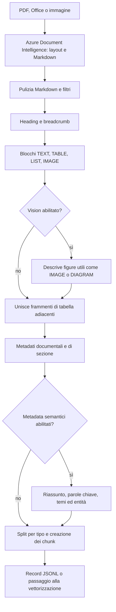

# Come vengono preparati i documenti

Il chunking trasforma un documento originale in unità di contenuto che conservano la sezione, la pagina e il tipo di informazione. Il flusso è implementato in `rag/ingestion/document_chunker.py` e nei componenti sotto `rag/ingestion/steps/`.

## Flusso

## 1. Estrazione e normalizzazione

Azure Document Intelligence usa il modello `prebuilt-layout` e restituisce Markdown insieme alla struttura rilevata. Il testo viene pulito, le tabelle HTML convertite in Markdown e le figure inline rimosse: quando Vision è abilitato, l'informazione utile delle figure viene aggiunta separatamente come blocco descrittivo.

Il normalizzatore può escludere tabelle che sembrano dentro una figura, griglie di impaginazione o elementi ripetuti di intestazione/piè di pagina. Per questi ultimi il valore predefinito è `boilerplate_action=remove`. Se il Markdown non contiene un heading `#`, il nome del file diventa il titolo del documento.

Document Intelligence legge direttamente i formati supportati dal servizio, senza una conversione intermedia in PDF. L'endpoint API limita gli upload ai tipi elencati in `rag/api.py` e a 25 MB; l'ingestione CLI è un flusso separato.

## 2. Sezioni, pagine e blocchi

Gli heading Markdown da `#` a `######` delimitano le sezioni. Il breadcrumb contiene il titolo del documento e il percorso dei capitoli. I titoli numerati, come `2.1`, ricostruiscono il percorso gerarchico; un titolo non numerato eredita il capitolo numerato precedente.

Il parser crea blocchi contigui di questi tipi:

| Tipo | Riconoscimento o provenienza |
|---|---|
| `TEXT` | Testo che non corrisponde agli altri tipi. |
| `TABLE` | Righe Markdown che iniziano e finiscono con `|`. |
| `LIST` | Righe che iniziano con un marcatore di elenco o numerazione. |
| `IMAGE` | Riga Markdown con un'immagine, oppure descrizione di una schermata aggiunta da Vision. |
| `DIAGRAM` | Descrizione di un diagramma aggiunta da Vision. |

I marcatori `PageBreak` incrementano il numero di pagina associato ai blocchi. La pagina è un riferimento utile alla fonte, non una ricostruzione delle coordinate grafiche originali.

Con `ENABLE_VISION=true`, Document Intelligence fornisce i ritagli delle figure. Quelle sotto `MIN_VISUAL_AREA_RATIO` (default 1% della pagina) vengono scartate; Azure OpenAI Vision classifica le altre come decorative, immagini o diagrammi. Le decorative sono ignorate, mentre le immagini utili vengono descritte in poche righe e aggiunte come blocchi atomici alla sezione della pagina corrispondente. Vision è disattivato per default e comporta chiamate e costi aggiuntivi.

## 3. Unione e metadati

Prima di creare i chunk, vengono uniti solo frammenti di tabella adiacenti con lo stesso numero di colonne e la stessa intestazione normalizzata.

Ogni sezione riceve metadati deterministici: file e tipo sorgente, titolo, percorso della sezione, profondità, tipi di contenuto e presenza di tabelle o figure. `source_version` è un hash SHA-256 del file. Se `ENABLE_SEMANTIC_METADATA=true`, una chiamata Azure OpenAI per sezione aggiunge riassunto in italiano, parole chiave, temi, entità e documenti citati. Il testo passato a questa fase è limitato a 6.000 caratteri; un errore di arricchimento non interrompe l'intera ingestione.

## 4. Regole di divisione

La dimensione di default viene da `CHUNK_SIZE=1000` token con `CHUNK_OVERLAP=200`; il conteggio usa `tiktoken` con `cl100k_base`.

| Blocco | Regola |
|---|---|
| `TEXT` | `TokenTextSplitter` divide il testo in finestre con overlap. Dopo la pulizia si scartano i frammenti con meno di 15 token. |
| `TABLE` | Resta intera sotto `TABLE_MAX_TOKENS=800`. Se supera la soglia viene divisa per righe e l'intestazione viene ripetuta su ogni parte. |
| `LIST` | Resta atomica per non separare gli elementi dal loro contesto. |
| `IMAGE` / `DIAGRAM` | La descrizione resta atomica. |

La pulizia rimuove i marker `<figure>` e i commenti HTML di Document Intelligence. L'overlap è quindi applicato ai blocchi di testo, non alle tabelle, liste o descrizioni visuali.

## 5. Identità e risultato

`document_key` identifica logicamente un documento. Se non viene specificata, si usa il nome del file; il `doc_id` è l'hash SHA-256 della chiave normalizzata. Usare una chiave stabile permette di sostituire i chunk del documento durante una nuova ingestione.

Ogni chunk conserva:

- un `chunk_id` stabile rispetto a documento, sezione, tipo, posizione e contenuto;
- `content`, cioè il contenuto pulito;
- `contextualized_content`, cioè il breadcrumb davanti al contenuto;
- pagina, tipo, token count e metadati della sezione.

La deduplicazione elimina contenuti normalizzati identici solo all'interno della stessa sezione, conservando duplicati presenti in sezioni diverse. `export_jsonl()` può salvare un record per riga; l'ingestione normale passa invece il risultato direttamente alla pipeline di vettorizzazione.