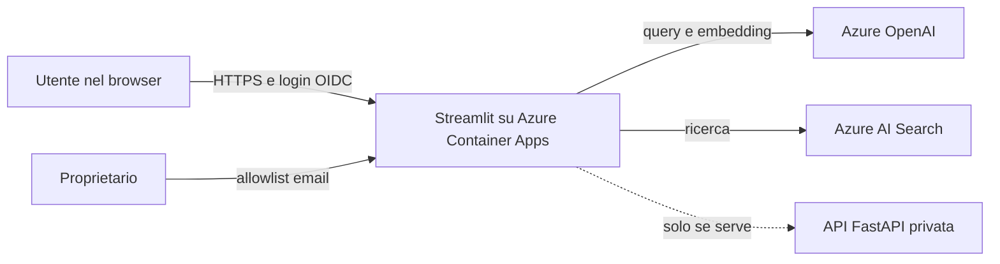

# Pubblicazione e gestione degli accessi

Questa guida descrive come pubblicare RAGSimple su Azure Container Apps e invitare o revocare singole persone. L'app usa un provider OpenID Connect (OIDC) per il login e un elenco privato di indirizzi autorizzati; non gestisce password degli utenti.

## Architettura di pubblicazione

Per il primo rilascio, pubblicare solo Streamlit. L'app web comunica direttamente con Azure OpenAI e Azure AI Search; l'API FastAPI serve flussi separati di ricerca e ingestione e non è necessaria alla chat Streamlit.



Il container espone Streamlit sulla porta `8501`. In produzione, pubblicare tale porta con ingress HTTPS esterno. Non pubblicare la porta `8000` dell'API finché non esiste un requisito specifico e una sua strategia di autenticazione e protezione.

## Prima di pubblicare

1. Verificare che `.env`, `docs/KB/`, `eval/` e `output/` non siano tracciati da Git. Nel repository sono esclusi: `.env` contiene credenziali, mentre corpus e valutazioni possono contenere dati riservati.
2. Se una chiave Azure è mai stata inserita in un commit o condivisa, ruotarla prima della pubblicazione. Aggiungere `.env.example`, che contiene segnaposto, non il file `.env` reale.
3. Preparare una subscription Azure con Azure OpenAI e Azure AI Search già configurati. Azure Document Intelligence è necessario solo per ingestire nuovi documenti; Vision e metadata semantici sono opzionali.
4. Creare un Azure Container Registry (ACR) e un ambiente Azure Container Apps.

## Pubblicare il container web

Dalla cartella root del repository, autenticarsi con Azure CLI e costruire l'immagine in ACR. Il comando esegue il build nel cloud e non richiede un Docker Hub pubblico:

```powershell
az login
az account set --subscription <SUBSCRIPTION_ID>
az acr build --registry <NOME_ACR> --image ragsimple-web:1.0.0 .
```

Nel portale Azure:

1. Creare una Container App usando l'immagine `ragsimple-web:1.0.0` nel registry.
2. Abilitare l'ingress esterno sulla porta target `8501`. Conservare l'URL HTTPS assegnato alla Container App.
3. Non aggiungere ingress pubblico all'API. Per questa prima versione, l'app web non ne ha bisogno.
4. Configurare variabili applicative e segreti come descritto sotto. L'immagine richiede autenticazione per default: se la configurazione OIDC manca, l'avvio si interrompe intenzionalmente.

## Configurare il provider di login

La UI usa il login OIDC integrato in Streamlit. Microsoft Entra ID è una scelta naturale per una distribuzione Azure; è possibile usare anche Google o un altro provider OIDC compatibile.

1. Nel provider, registrare una nuova applicazione web.
2. Impostare come redirect URI l'URL HTTPS della Container App seguito da `/oauth2callback`, ad esempio `https://<nome-app>.<dominio-azure>/oauth2callback`.
3. Scegliere quali tipi di account possono autenticarsi. Per utenti esterni a un tenant Microsoft, verificare la configurazione di account multitenant/guest e le policy di consenso del tenant.
4. Recuperare `client_id`, creare un `client_secret` e individuare l'URL OIDC di discovery. Per Entra ID, il formato tipico è `https://login.microsoftonline.com/<TENANT_ID>/v2.0/.well-known/openid-configuration`.
5. Verificare che il provider restituisca il claim `email`. L'app confronta l'indirizzo restituito con l'elenco autorizzato; un account senza claim email viene negato.
6. Generare un segreto cookie lungo e casuale, per esempio da PowerShell:

```powershell
python -c "import secrets; print(secrets.token_urlsafe(48))"
```

Configurare l'URI di callback identico sia nel provider sia nella Container App. Un URI diverso, anche solo per protocollo o percorso, impedisce il ritorno dal login.

## Configurare variabili e segreti

Impostare nella Container App:

| Nome | Uso |
|---|---|
| `AUTH_REQUIRED` | Impostare `true` in produzione. |
| `ALLOWED_USER_EMAILS` | Email autorizzate separate da virgola, ad esempio `persona1@example.com,persona2@example.com`. |
| `OIDC_REDIRECT_URI` | URL pubblico completo che termina in `/oauth2callback`. |
| `OIDC_CLIENT_ID` | ID dell'applicazione registrata nel provider. |
| `OIDC_METADATA_URL` | URL del documento OIDC di discovery. |
| `OIDC_CLIENT_SECRET` | Segreto dell'app OIDC. Conservarlo come secret Azure. |
| `OIDC_COOKIE_SECRET` | Segreto casuale per la sessione Streamlit. Conservarlo come secret Azure. |
| `OPENAI_URL`, `OPENAI_KEY` | Endpoint e chiave Azure OpenAI; la chiave è un secret. |
| `OPENAI_DEPLOYMENT_NAME`, `OPENAI_API_VERSION` | Deployment chat e versione API. |
| `SEARCH_URL`, `SEARCH_KEY`, `INDEX_NAME` | Endpoint, chiave Azure AI Search e indice; la chiave è un secret. |
| `EMBEDDING_MODEL`, `EMBEDDING_DEPLOYMENT_NAME`, `EMBEDDING_DIMENSIONS` | Modello e dimensione usati per interrogare l'indice esistente. |

Conservare tutte le chiavi e i segreti nella sezione **Secrets** di Container Apps e referenziarli nelle variabili d'ambiente. Non inserirli nell'immagine, nel repository, in un file `secrets.toml` tracciato o in una schermata condivisa.

## Invitare e revocare una persona

Non c'è una pagina amministrativa per gestire utenti: il proprietario aggiorna `ALLOWED_USER_EMAILS` nella configurazione della Container App.

- **Invitare:** aggiungere l'email all'elenco, salvare la configurazione e verificare che la nuova revisione riceva traffico.
- **Revocare:** rimuovere l'email e attivare la nuova revisione. Il cookie OIDC da solo non autorizza l'accesso: l'app ricontrolla l'elenco durante le interazioni.
- **Sessione già aperta:** chiedere alla persona di ricaricare la pagina o chiudere e riaprire la sessione dopo la revisione. Se serve un blocco immediato, fermare o ritirare anche la revisione che sta ancora servendo la vecchia configurazione.

Gli indirizzi vengono confrontati senza distinzione tra maiuscole e minuscole. Evitare la registrazione aperta a tutti: ogni domanda usa risorse Azure a carico del proprietario. Impostare un budget Azure e controllare consumo e log.

## Collaudo prima di condividere il link

1. Aprire il link in una finestra anonima e verificare che venga richiesto il login.
2. Accedere con un account presente nell'allowlist e provare una domanda con una fonte nota.
3. Accedere con un account non presente e verificare che la chat non sia disponibile.
4. Rimuovere temporaneamente un account autorizzato, attivare la revisione e verificare il diniego dopo aver ricaricato la sessione.
5. Verificare che il browser usi HTTPS e che `/docs` dell'API non sia raggiungibile pubblicamente.

## Cosa non fare

- Non cambiare i binding locali `127.0.0.1` del Compose per usarlo come server pubblico.
- Non esporre l'API su Internet protetta soltanto da una chiave statica senza ulteriori limiti e controlli.
- Non abilitare `AUTH_REQUIRED=false` in un ambiente pubblico.
- Non inserire chiavi Azure, segreti OIDC, corpus o workbook diagnostici in un commit.