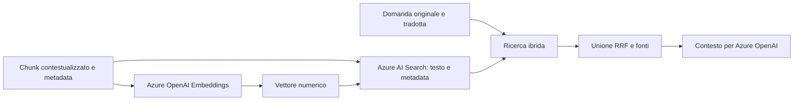

# Vettorizzazione e ricerca

Questa guida segue il percorso dei chunk da quando sono pronti per l'indice fino al recupero delle fonti per una domanda. I componenti principali sono `IndexingPipeline`, `IndexStore` e `QueryEngine`.

## In poche parole

Un embedding è una lista di numeri che rappresenta il significato di un testo. Azure AI Search può confrontare i vettori della domanda con quelli dei chunk e trovare contenuti simili anche quando le parole non coincidono esattamente.

## Che cosa viene trasformato in vettore

Per ogni chunk, l'indexing usa `contextualized_content`; se manca, ripiega su `content`. Il testo contestualizzato include il breadcrumb, per esempio `Documento: Manuale. Sezione: Accesso > Reset password.` davanti al contenuto.

Il testo e i metadata del chunk vengono inseriti in un `TextNode` LlamaIndex. La pipeline chiede a LlamaIndex il contenuto in modalità `EMBED`: oltre al testo, questa modalità aggiunge i metadata del nodo in forma testuale. Possono quindi entrare nell'embedding campi come percorso sezione, pagina, tipo di contenuto, sorgente e versione del documento. I metadata sono anche salvati nell'indice per filtraggio e citazioni.

## Modello e dimensione

L'app crea `AzureOpenAIEmbedding` usando l'endpoint Azure OpenAI configurato. La configurazione distingue:

- `EMBEDDING_MODEL`: alias del modello;
- `EMBEDDING_DEPLOYMENT_NAME`: deployment Azure effettivamente chiamato;
- `EMBEDDING_DIMENSIONS`: dimensione attesa dei vettori, default 1536.

Il deployment usato in ingestione e quello usato in ricerca devono essere lo stesso modello compatibile con l'indice. L'indice Azure AI Search è creato automaticamente se manca e riceve la dimensione configurata. Cambiare modello o dimensione richiede un indice compatibile e la nuova generazione dei vettori per tutti i documenti; non mescolare vettori prodotti da modelli diversi.

## Scrittura nell'indice

Per ciascun documento, l'app calcola gli embedding in batch e controlla che il numero di vettori corrisponda al numero di chunk. Un disallineamento interrompe l'indicizzazione. Azure AI Search conserva vettore e testo, oltre a campi come `chunk_id`, `doc_id`, `section_id`, breadcrumb, pagina, tipo e `source_version`.

Prima di inserire una nuova versione, la pipeline elimina dall'indice i nodi collegati al `doc_id` e inserisce i nuovi chunk. Re-ingestire con la stessa `document_key` sostituisce quindi la versione precedente del documento; usare una chiave diversa crea un documento distinto.

## Come una domanda trova le fonti

1. La domanda viene ripulita e controllata.
2. Azure OpenAI la traduce nell'altra lingua tra italiano e inglese; per altre lingue produce una versione inglese. Se la traduzione fallisce, resta utilizzabile la domanda originale.
3. Il retriever cerca sia la domanda originale sia quella tradotta. `HYBRID_SEARCH=true` (default) combina segnali vettoriali e testuali.
4. Se `MIN_RELEVANCE_SCORE` è configurato, i risultati sotto soglia vengono scartati prima dell'unione.
5. I risultati vengono fusi con Reciprocal Rank Fusion (RRF): un chunk in alto in entrambe le ricerche sale in classifica. Il sistema usa la costante 60 e mantiene al massimo `top_k` risultati.
6. Il contenuto recuperato, con documento, sezione e pagina, diventa il contesto dato al modello di chat.

I punteggi mostrati dopo la fusione sono punteggi di ordinamento, non probabilità di correttezza. `top_k` di default è 5; la UI consente da 1 a 10, l'API da 1 a 50.

## Costi e controlli

La ricerca multilingue aggiunge una chiamata di traduzione e una seconda ricerca quando la traduzione differisce dall'originale. L'embedding durante l'ingestione e la generazione della risposta sono costi Azure separati. Misurare il consumo con domande rappresentative prima di invitare utenti esterni e tarare `MIN_RELEVANCE_SCORE` su un dataset di valutazione: una soglia arbitraria può nascondere fonti utili.